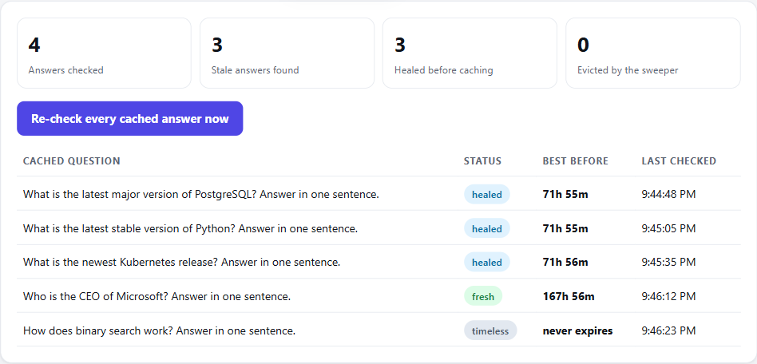

<div align="center">


# BestBefore

**A self-healing semantic cache for Bifrost. Stale AI answers are rewritten with today's verified facts before they are cached, and every cached answer gets a best-before date.**

[](LICENSE)
[](#built-during-the-hackathon)
[](https://github.com/maximhq/bifrost)
[](https://tavily.com)
[](https://github.com/AlgoMasterArpit/HackCulture/actions/workflows/ci.yml)

**[Pitch deck](docs/pitch-deck.pdf)** · **[Eval results](eval/RESULTS.md)** · **[Adversarial reviews](docs/REVIEW.md)**

Global AI Hackathon 2026 · Team **stackoverflow** · Statement 04 *Open-Source Bifrost Gateway* + Statement 06 *Stale-Answer Detector*

</div>

<p align="center"></p>

<p align="center"><sub>A live run on 11 Nov 2026. Gemini 2.5 Flash answered from its training data: "Python 3.12.1". BestBefore pulled out the claim, Tavily found Wikipedia, the judge had to quote it word for word, Go confirmed the new value is in that quote, and the answer was rewritten to "3.15 [1]" with the source attached. That corrected answer is what Bifrost cached. Asking again was a cache hit that returned the corrected answer in 1.1 seconds, with no model call.</sub></p>

## Contents

- [At a glance](#at-a-glance)
- [What no TTL cache does](#what-no-ttl-cache-does)
- [Results](#results)
- [How it works](#how-it-works)
- [How Bifrost and Tavily are used](#how-bifrost-and-tavily-are-used)
- [Run it](#run-it)
- [Use it from your own app](#use-it-from-your-own-app)
- [Add BestBefore to your own Bifrost](#add-bestbefore-to-your-own-bifrost)
- [Configuration](#configuration)
- [Reproduce the numbers](#reproduce-the-numbers)
- [Tests](#tests)
- [Limits](#limits)
- [Repository layout](#repository-layout)
- [Built during the hackathon](#built-during-the-hackathon)

## At a glance

| | |
|---|---|
| **Problem** | A model answers from frozen training data: "the latest Python is 3.12", "Parag Agrawal runs Twitter". A gateway's semantic cache then replays that answer to every user who asks again, until the TTL runs out. In Bifrost today the clock is the only thing that removes a cached answer: [`isExpiredEntry`](https://github.com/maximhq/bifrost/blob/plugins/semanticcache/v1.7.7/plugins/semanticcache/search.go#L252) checks `expires_at` and nothing else, and even expired entries are only cleaned up lazily ([#2414](https://github.com/maximhq/bifrost/issues/2414)). |
| **What we built** | A Bifrost plugin that runs between the model and the cache. It finds the claims in each answer that can go out of date, checks them against Tavily search results, and makes the judge model prove every verdict with a word-for-word quote. Plain Go makes the decision. A stale answer is **rewritten with the verified values before the cache stores it**, so the cache only ever holds corrected text. Every cached answer gets a **best-before date**, and a background sweeper re-checks it when that date passes. |
| **Why Bifrost + Tavily** | Bifrost is where every answer passes and where the cache lives, so one plugin protects every app with no code change, and its plugin order lets us edit the answer before the cache writes it. Tavily supplies the live evidence. Take either away and nothing works. |
| **Proof** | <!-- proof:start -->Live, 10 time-sensitive questions asked twice through each gateway: a TTL-only cache delivered 12 stale answers out of 20; with BestBefore, 1, and 5 repeat asks were served the corrected answer straight from the cache (median 0.08s). 8 answers could not be proven either way and were delivered flagged. On 60 hand-labelled answers, BestBefore caught 75% of the stale ones, healed 93% of those it caught, and wrongly flagged 0% of the good ones. On this clean set the quote check cost 20 points of recall and prevented no false alarm, because nothing here tries to fool the judge; it exists for poisoned pages and invented quotes, which the [attack tests](docs/REVIEW.md) show the judge alone would act on. 85% of timeless answers cost nothing at all.<!-- proof:end --> |

## What no TTL cache does

**1. It heals instead of just flagging.** Other answer-checkers stop at "this looks outdated". BestBefore corrects the answer from the evidence, cites the source, and caches the corrected version. The first user gets the right answer, and so does everyone after them, served from cache. A rewrite only counts if Go finds every verified new value in it; otherwise the stale answer is not cached at all.

**2. Cached answers carry a best-before date.** Each claim kind is trusted for a set time (prices 24h, versions 72h, leadership and laws 7 days). Inside that window, cache hits cost nothing. The cache entry's own TTL is set to the same date, so even an answer the ledger never saw cannot be replayed past it. When it passes, a background sweeper re-checks the answer **before any user asks again**, and evicts it if the world changed.

**3. It costs nothing where it does not matter.** Only answers headed for the cache are checked; everything else passes with no delay. A cache hit past its best-before date is served at once and re-checked in the background (stale-while-revalidate), and a burst of hits on one entry pays for a single check. Streams are checked when they finish: a stale stream gets a correction appended and is kept out of the cache.

**4. Every decision carries its proof, and it fails safe.** The model drafts and advises; Go decides. Each claim ships with its source, its verbatim quote and, when a verdict is thrown out, the reason. If the checker or search is down, nothing is evicted.

<p align="center"></p>

<p align="center"><sub>The live Cache freshness tab right after the evaluation run: the cache comparison's questions are cached, eight of them healed before caching and one left uncertain, each with its best-before countdown. The counters cover the whole session, including the 60-answer eval.</sub></p>

## Results

All numbers come from [`eval/cache.py`](eval/cache.py) and [`eval/run.py`](eval/run.py) against the real gateway, with Gemini as the answering model and the judge, and live Tavily search. [`eval/report.py`](eval/report.py) writes [eval/RESULTS.md](eval/RESULTS.md), these tables and the charts from the same JSON. No number below was typed by hand.

<!-- results:start -->
| Live: 10 questions, each asked twice | Bifrost cache, TTL only | Bifrost cache + BestBefore |
|---|---|---|
| The model's first answer was out of date | 6 of 10 | 6 of 10 |
| **Stale answers delivered to users** | **12 of 20** | **1 of 20** |
| Answers that could not be proven either way, delivered flagged | 6 | 8 |
| Repeat asks served from cache | 10 | 9 |
| ...with the corrected answer | 0 | 5 |
| Repeat-ask time, median | not comparable¹ | 0.08s |

¹ The baseline gateway runs the plugin as an observer so stale answers can be counted, and the observer re-checks every cache hit, which makes its repeat asks slow. A real TTL-only cache answers a hit as fast as BestBefore does. When the observer could not re-check a hit (free-tier quota), the hit is the first answer's exact text, so it is counted with that answer's verdict.

| Labelled answers | LLM verdict alone | BestBefore |
|---|---|---|
| Stale answers caught | 95% | **75%** |
| Good answers wrongly flagged stale | 0% | **0%** |
| A stale flag is right | | 100% |
| Stale answers rewritten with the verified values | | 93% |
| Timeless answers checked for free (no model, no search) | | 85% |
| Judge tokens per checked answer | | 3338 |
| Tavily searches per checked answer | | 1.5 |
| Added latency, p50 / p95 | | 6.8s / 17.5s |
| Judge verdicts thrown out because the quote did not prove them | | 6 |

**Earlier runs, also published.** Our first run used a stricter quote rule, which threw out real contradictions worded differently from the source ("JDK 25" for "Java 25", a three-word "Latest version: 19.3"). It caught 65% of stale answers and wrongly flagged 0% of good ones; a repeat with the same rule gave 65% and 0%. We changed the rule after reading those misses, and later stopped the extractor dropping negations ("not yet adopted") after reading another; the table above is the same 60 answers on the final build. Because the rule was tuned after seeing this data, treat these as development numbers, not a held-out test. Every run is in [eval/results/](eval/results/), and every rejected verdict carries its reason.

**Held-out test.** 16 more answers about prices, laws and leadership were written and labelled after the rule was settled, committed, and only then run once ([eval/holdout.json](eval/holdout.json)). BestBefore caught **89%** of the stale ones, wrongly flagged **14%** of the good ones, and rewrote 78% of the answers it flagged with the verified values. It ran on the build before the last two fixes (the extractor keeping negations, plain grammar words in rewrites), and we did not re-run it. The one false alarm (hf3) is likely our label's fault: we wrote that Spotify raised the price in July 2024, and the cited CNBC article says June 2024. It stays counted against us.

<!-- results:end -->

<p align="center"></p>

<p align="center"></p>

<p align="center"></p>

The labelled set is [eval/claims.json](eval/claims.json): 20 stale answers (true once, outdated before 11 Nov 2026), 20 fresh ones (time-sensitive, still true) and 20 timeless ones. Each label carries the reason it was given. Every answer and its evidence is listed in [eval/RESULTS.md](eval/RESULTS.md), mismatches included.

## How it works

<p align="center"></p>

Bifrost runs plugin hooks on the way back in reverse order, so BestBefore's `PostLLMHook` runs **before** the built-in semantic cache writes the answer. That ordering is what makes healing possible ([decision log](docs/DECISIONS.md)).

1. **Regex gate (free).** [`freshness/detect.go`](freshness/detect.go) looks for prices, version numbers, laws, leadership words and "latest / currently / as of". An answer with none of them is `timeless` and costs nothing: no model call, no search.
2. **Extract claims.** The judge model rewrites the flagged sentences into atomic, self-contained claims, each with a kind and a search query. At most `max_claims` per answer.
3. **Search.** Each claim is searched with Tavily, in parallel. When the extractor names the site that publishes the authoritative value (python.org, kubernetes.io, gov.uk), a second search restricted to that site runs alongside, and its results are marked official and listed first.
4. **Judge with proof.** The judge gets the sources, is told to prefer official and recent ones, and must return `supported`, `contradicted` or `unverifiable`, the source number and an exact quote from it.
5. **Score in Go.** [`scoreClaim`](freshness/verify.go) keeps a verdict only if the quote appears word for word in that source (at least five words for support, three for a contradiction). For a contradiction, the words of the stated current value that are not already in the claim must all be in the quote, so quoting the old value back or inventing a new one proves nothing. A kept verdict moves the score toward 0.9 or 0.1, weighted by Tavily's relevance. The answer's score is its weakest claim's.
6. **Heal if stale.** [`freshness/heal.go`](freshness/heal.go) asks the model to rewrite only the outdated statements, with numbered citations. Go accepts the draft only if it changes the answer, contains every verified new value, no longer contains any number that was only in the outdated claim, uses no words beyond the original answer and the verified values, has no links, and stays within twice the original length. Go then appends the source URLs itself. The accepted text replaces the answer before the cache stores it.

| Result | What the user gets | What the cache keeps |
|---|---|---|
| `healed` | The corrected answer with sources, plus the original marked outdated | The corrected answer, with a best-before date |
| `stale` (rewrite failed) | The original, flagged with today's value and source | Nothing: the write is skipped with the cache's own `no_store` switch |
| `fresh` | The answer as it was | The answer, with a best-before date |
| `uncertain` / `unchecked` | The answer, flagged | The answer; nothing is ever evicted on a guess or an outage |
| `timeless` | The answer | The answer, never re-checked |

**On a cache hit**, the stored report is reused while the answer is inside its best-before date. Past it, the hit is served at once and re-checked in the background (`revalidate: "background"`, the default); if it went stale, the entry is evicted, so the next miss caches a healed one. With `revalidate: "inline"` the hit waits for the check and the user gets a healed copy. **On a timer**, the sweeper re-checks entries past their date without waiting for any user.

**Streams** are collected chunk by chunk and checked on the final chunk. The text has already reached the user, so a stale stream cannot be rewritten in place: the correction is appended as a last delta ("Corrected by BestBefore: ..."), the report rides on the final chunk at `extra_fields.raw_response.bestbefore`, and the stale stream is kept out of the cache.

**Scope.** By default (`check_scope: "cached"`) only requests that opt into the semantic cache with `x-bf-cache-key` are checked, because those answers are replayed to other users. Set `check_scope: "all"` to check every chat answer.

Every checked response carries the report in its body and as `x-bestbefore-*` headers. This is the report from the live run in the screenshot above, unedited:

```json
"bestbefore": {
  "status": "healed",
  "freshness_score": 0.1,
  "claims": [
    {
      "claim": "The latest stable version of Python is 3.12.1.",
      "kind": "version",
      "status": "stale",
      "freshness_score": 0.1,
      "current_value": "3.15",
      "source_url": "https://en.wikipedia.org/wiki/History_of_Python",
      "quote": "As of October 2026( Python 3.15 is the latest stable release.",
      "model_verdict": "contradicted",
      "grounded": true
    }
  ],
  "checked_at": "2026-11-11T15:06:57.623739253Z",
  "recheck_after": "2026-11-14T15:06:57.623739253Z",
  "searches": 1,
  "judge_tokens": 2695,
  "latency_ms": 21583,
  "origin": "verified",
  "cache_hit": false,
  "cache_evicted": false,
  "healed": true,
  "original_answer": "The latest stable version of Python is 3.12.1.",
  "corrected_answer": "The latest stable version of Python is 3.15[1].\n\nSources:\n[1] https://en.wikipedia.org/wiki/History_of_Python"
}
```

```
x-bestbefore-status: healed
x-bestbefore-healed: true
x-bestbefore-score: 0.10
```

`freshness_score` is the score of the original answer. A rejected verdict is kept in the report with `"grounded": false`, a `rejected_because` reason and the `rejected_quote`, so every decision can be audited.

## How Bifrost and Tavily are used

| Capability | How BestBefore uses it | Code |
|---|---|---|
| Bifrost plugin order, `PostLLMHook` | Runs before the built-in semantic cache writes the response, so a stale answer is replaced with the corrected one and the cache stores the fix. | [`hooks.go`](hooks.go) |
| Bifrost cache switch `semantic_cache-no_store` | A stale answer that could not be healed is never written to the cache. | [`hooks.go`](hooks.go) |
| Bifrost `PreLLMHook` + request headers in context | Captures the question on cache misses, checks only requests that carry `x-bf-cache-key`, and skips the plugin's own judge calls by a per-process token. | [`hooks.go`](hooks.go) |
| Bifrost streaming, `PostLLMHook` per chunk + stream-end flag | Collects a stream, checks it on the final chunk, appends a correction and keeps a stale stream out of the cache. | [`hooks.go`](hooks.go) |
| Bifrost `HTTPTransportPostHook` | Sees every answer, cache hits included: annotates it and enforces best-before dates on hits: re-checks them in the background, or before answering (and heals them) with `revalidate: "inline"`. | [`hooks.go`](hooks.go) |
| Bifrost `HTTPTransportPreHook` | Serves three virtual models inside the OpenAI API: `bestbefore/verify` (check any answer), `bestbefore/status` (the ledger and counters) and `bestbefore/sweep` (re-check everything now). | [`hooks.go`](hooks.go) |
| Bifrost cache API, `cache_debug.cache_id` + `DELETE /api/cache/clear/{id}` | Ties each answer to its cache entry, and evicts entries that went stale. | [`main.go`](main.go), [`sweeper.go`](sweeper.go) |
| Bifrost `/v1/chat/completions` with `fallbacks` and retries | The judge's and healer's own calls go back through the gateway, so they get model fallback, retries on 503s, logs and budgets. | [`freshness/clients.go`](freshness/clients.go) |
| Tavily `/search` | Live evidence for each claim: URL, page text, date and a relevance score that weights the freshness score. | [`freshness/clients.go`](freshness/clients.go) |
| Tavily `include_domains` | A second search restricted to the claim's official site, so the judge sees the authoritative page first. | [`freshness/clients.go`](freshness/clients.go), [`freshness/verify.go`](freshness/verify.go) |
| Tavily through a Bifrost relay (optional) | Point `tavily_url` at `/relay/tavily` and set `virtual_key`, and searches are logged and costed in Bifrost too. Supported in code; we ran with direct Tavily. | [`freshness/clients.go`](freshness/clients.go) |

**Gemini** writes the answers in the demo and is the judge and healer. Any provider Bifrost supports works: change `judge_model`.

A note on the free tier: Gemini 2.5 Flash allows only 20 requests a day per project on a free key. Each model has its own daily quota, so the judge falls back across three models (3.5 Flash-Lite, 3.1 Flash-Lite, Gemma 4), and the demo page asks Gemini 2.5 Flash with Gemma 4 as its fallback. When one returns a quota error, Bifrost moves to the next.

## Run it

You need Docker, a [Gemini API key](https://aistudio.google.com/apikey) and a [Tavily API key](https://app.tavily.com). Both have free tiers.

```bash
git clone https://github.com/AlgoMasterArpit/HackCulture.git bestbefore
cd bestbefore
cp .env.example .env          # then paste your two keys into .env
docker compose pull gateway   # prebuilt Bifrost + plugin image from GitHub Container Registry
docker compose up -d
```

The image is built and published by [CI](.github/workflows/image.yml) on every push, for x86-64. On an Apple Silicon Mac, or to build it yourself, run `docker compose up -d --build` instead (it compiles Bifrost from source, 15–30 minutes).

Then open:

- **http://localhost:3000** for the demo page: ask through the gateway, check any answer, and watch the Cache freshness tab. The Side by side tab asks a plain TTL-only Bifrost cache and BestBefore the same question twice; it needs the plain gateway too: `docker compose --profile baseline up -d`.
- **http://localhost:8080** for the Bifrost dashboard. Its Logs page shows the judge and healer calls.

Why building is slow: Go plugins only load into a gateway built with the exact same Go version, libc and dependency versions, and the official Bifrost image is statically linked so it cannot load plugins at all. The [Dockerfile](Dockerfile) builds Bifrost v2.5.1 and the plugin side by side, and [scripts/align-deps.sh](scripts/align-deps.sh) pins every shared module to the gateway's version, including Bifrost's own `replace` of `mcp-go`, without which `plugin.Open` refuses the plugin. The Go tests run during the build too.

No keys yet? Run the whole thing offline against a mock provider and a mock web whose prices the test can change:

```bash
docker compose -f e2e/compose.yml up -d --build
python e2e/test_gateway.py      # expect: 8 of 8 passed
```

The mock stack also uses port 8080, so stop the live stack first (`docker compose down`), and stop the mock stack when you are done (`docker compose -f e2e/compose.yml down`). Where `python` is Python 2 or missing, use `python3`.

If the build fails on Windows with `invalid file request`, the repo is probably inside a OneDrive folder: OneDrive turns files into cloud placeholders that Docker cannot read. Clone it somewhere else, such as `C:\code`.

## Use it from your own app

Point any OpenAI-compatible client at the gateway. Nothing else changes; stale answers come back corrected.

```bash
curl -s http://localhost:8080/v1/chat/completions \
  -H "Content-Type: application/json" \
  -H "x-bf-cache-key: my-app" \
  -d '{"model": "gemini/gemini-2.5-flash",
       "fallbacks": ["gemini/gemma-4-26b-a4b-it"],
       "messages": [{"role": "user", "content": "What is the latest stable version of Python?"}]}' \
  | jq '{answer: .choices[0].message.content, freshness: .bestbefore.status}'
```

Check and correct an answer you already have, from any source, with the `bestbefore/verify` model. The last message is the answer; the one before it, if any, is the question:

```python
from openai import OpenAI

client = OpenAI(base_url="http://localhost:8080/v1", api_key="unused")
result = client.chat.completions.create(
    model="bestbefore/verify",
    messages=[
        {"role": "user", "content": "Who is the CEO of Twitter?"},
        {"role": "assistant", "content": "Parag Agrawal is the CEO of Twitter."},
    ],
)
report = result.model_extra["bestbefore"]
print(report["status"], report.get("corrected_answer"))
```

See what is cached and when each answer expires, or re-check everything now:

```bash
curl -s localhost:8080/v1/chat/completions -H "Content-Type: application/json" \
  -d '{"model": "bestbefore/status", "messages": []}' | jq .bestbefore_status
curl -s localhost:8080/v1/chat/completions -H "Content-Type: application/json" \
  -d '{"model": "bestbefore/sweep", "messages": []}' | jq .bestbefore_status.swept
```

## Add BestBefore to your own Bifrost

The plugin is a Go plugin (`.so`), so it must be built with the same Go version and dependency versions as the gateway, and the gateway must be built dynamically linked. The official Bifrost image is static and cannot load plugins.

```bash
git clone --depth 1 --branch transports/v2.5.1 https://github.com/maximhq/bifrost
cd bifrost && make build DYNAMIC=1 && cd ..           # Go 1.27.3; a dynamically linked gateway
git clone https://github.com/AlgoMasterArpit/HackCulture.git bestbefore
sh bestbefore/scripts/align-deps.sh bifrost/transports bestbefore   # pin shared modules to the gateway's
cd bestbefore && go build -buildmode=plugin -o bestbefore.so .
```

Then add the plugin entry below to the gateway's `config.json`, with `path` pointing at `bestbefore.so`, and turn on the semantic cache. The [Dockerfile](Dockerfile) does exactly these steps.

## Configuration

The plugin entry in [config.json](config.json):

```json
{
  "enabled": true,
  "name": "bestbefore",
  "path": "/app/plugins/bestbefore.so",
  "config": {
    "judge_model": "gemini/gemini-3.5-flash-lite",
    "judge_fallbacks": ["gemini/gemini-3.1-flash-lite", "gemini/gemma-4-26b-a4b-it"],
    "tavily_api_key": "env.TAVILY_API_KEY",
    "max_claims": 4,
    "timeout_seconds": 60,
    "sweep_interval": "1m",
    "admin_models": true
  }
}
```

| Key | Default | Meaning |
|---|---|---|
| `judge_model` | required | Model that extracts, judges and heals claims, as `provider/model`. |
| `judge_fallbacks` | none | Models Bifrost falls back to when the judge fails. |
| `tavily_api_key` | required unless `virtual_key` | Tavily key, or `env.NAME` to read it from the environment. |
| `heal` | `true` | Rewrite stale answers with the verified values. Set `false` to only flag and evict. |
| `check_scope` | `cached` | Check only answers headed for the semantic cache (requests with `x-bf-cache-key`), or `all` to check every chat answer. |
| `revalidate` | `background` | For a cache hit past its best-before date: serve it now and re-check behind the scenes, or `inline` to re-check before answering. |
| `sweep_interval` | `5m` | How often the sweeper looks for cached answers past their best-before date. `"0"` turns it off. |
| `recheck_windows` | prices 24h, versions 72h, recency 24h, leadership 7d, regulation 7d | Override how long each claim kind is trusted, for example `{"pricing": "6h"}`. Keys: `pricing`, `version`, `recency`, `leadership`, `regulation`. |
| `evict_stale` | `true` | Set `false` to flag stale answers without touching the cache. |
| `admin_models` | `false` | Turn on `bestbefore/status` and `bestbefore/sweep`. They list cached questions and trigger paid re-checks, so keep them off on a shared gateway. The demo config turns them on for the dashboard. |
| `max_claims` | 4 | Claims checked per answer. Bounds cost. |
| `max_results` | 5 | Tavily results per claim. |
| `timeout_seconds` | 25 | Budget for the check, and separately for the rewrite. Our config uses 60 so provider retries fit. |
| `tavily_url` | `https://api.tavily.com` | Set to `http://127.0.0.1:8080/relay/<name>` to search through a Bifrost relay. |
| `virtual_key` | none | Bifrost virtual key sent with judge calls and relay searches. |
| `gateway_url` | `http://127.0.0.1:8080` | Where the plugin reaches its own gateway. |

## Reproduce the numbers

```bash
docker compose --profile baseline up -d   # adds a TTL-only gateway on :8081 where the plugin only observes
python eval/cache.py                      # 10 live questions, asked twice through each gateway
python eval/run.py                        # 60 labelled answers through bestbefore/verify
python eval/run.py --dataset holdout      # 16 held-out answers, labelled before they were ever run
python eval/report.py                     # writes eval/RESULTS.md, the README numbers and docs/img/eval-*.svg
```

The scripts use only the Python standard library. `run.py` paces itself for Gemini's free tier and stops rather than saving a run if three checks in a row fail; [eval/RESULTS.md](eval/RESULTS.md) records how long ours took.

## Tests

```bash
go test ./...                     # unit tests: detection, grounding, healing, scoring, ledger, sweeper, hooks
python e2e/test_gateway.py        # end to end against a real Bifrost with the plugin loaded (start e2e/compose.yml first)
```

The unit tests run inside the Docker build, so the image cannot build if they fail. Without Go installed:

```bash
docker run --rm -v "${PWD}:/w" -w /w -e CGO_ENABLED=0 golang:1.27.3-alpine3.24 go test ./...
```

**End to end, against a real Bifrost gateway** (8 of 8 pass, on every push in [CI](.github/workflows/ci.yml)): a stale answer is healed and the cache keeps the corrected text, so the second ask is a cache hit with the fix; when the mock web changes a price, the background sweeper evicts the now-stale cached answer before anyone asks, and the next ask gets a newly healed answer; a streamed stale answer gets a correction appended and is not replayed from the cache, while a fresh stream is cached and replayed; an answer not headed for the cache passes untouched; timeless answers cost nothing; `bestbefore/verify` heals a pasted answer; `bestbefore/status` lists cached answers with their best-before dates.

**Unit tests pin down:** six kinds of bad rewrite are rejected (unchanged, old value kept, a link, a markdown link, an injected sentence, a fake citation) and the stale answer is then not cached; six kinds of contradiction that prove nothing are never `stale`; web pages, questions and answers cannot forge prompt tags; a model or search outage is `unchecked`, never evicted; the plugin never checks its own judge calls; a client cannot forge the internal header. They pass under `go test -race`.

### Adversarial review

We asked a separate AI reviewer to break the plugin three times, given only the code: the checker, then healing and the sweeper, then streaming, background revalidation and the official-site search. Between them they found 35 problems, including seven high-severity ones such as a rewrite check that would have cached a "corrected" answer carrying a phishing link, and fresh streams cached with no best-before date. Each is fixed with a test that fails without the fix, apart from three trade-offs we document under Limits. The findings, fixes and tests are in [docs/REVIEW.md](docs/REVIEW.md).

## Limits

We would rather you read these here than find them yourself.

- **The first answer to a stale question is slower.** Checking and healing take extra model and search calls (see latency above). Only answers headed for the cache pay this, once per best-before window; repeat asks are served from cache, and uncached and timeless answers add nothing.
- **Deployments with `default_cache_key`** cache requests that carry no `x-bf-cache-key` header, which `check_scope: "cached"` cannot see; set `check_scope: "all"` there.
- **With raw-response capture on**, Bifrost may strip a stream's report from the final chunk. The correction text and the cache protection still apply.
- **Only the first choice is checked.** A request for several choices (`n` > 1) has only its first choice checked and corrected.
- **A streamed answer is corrected, not rewritten.** The stale text has already reached the user, so the correction is appended at the end, and the end of the stream waits for the check.
- **Background revalidation serves one answer on trust.** A hit past its best-before date is answered before its re-check finishes. The sweeper usually re-checks entries before that happens; set `revalidate: "inline"` to never serve without a fresh check.
- **The sweeper evicts but cannot pre-write.** Bifrost's cache has no API for a plugin to insert an entry, so after a sweep the next ask pays for one model call, which is then healed and cached.
- **The ledger and the demo cache live in memory.** Best-before dates reset on restart and are not shared between replicas; the demo uses Bifrost's in-process vector store, so its cache resets too. A persistent vector store and storing dates in its metadata would fix both.
- **The judge can still be wrong in a grounded way.** A real quote can be misread. In an earlier run it accepted "Gemini 1.5 Pro is Google's most capable Gemini model" as fresh, because Wikipedia calls it "the most capable model in the Gemini 1.5 family". One grounded source is enough, so an outdated or narrowly worded page can make a stale answer look fresh. Requiring two sources on different hosts would cut this, at the cost of recall.
- **The demo stack has no auth.** Ports 3000 and 8080 let anyone on your network spend your keys, and the demo turns on `admin_models`, so anyone who can reach it can trigger a sweep. Run it locally, or put Bifrost's virtual keys in front before exposing it.
- **Healing relies on Bifrost's default plugin order.** Custom plugins run after the built-in cache on the way in and before it on the way back. A custom `pre_builtin` placement would reverse that, and the cache would store the answer before it is healed.
- **Rewrites are deliberately conservative.** A correction may only reuse words from the answer and the verified values, so a rewrite that rephrases more than it needs to is rejected. The answer is then flagged and kept out of the cache, not healed.
- **The labelled set is ours.** 60 answers, labelled by us on 11 Nov 2026 with a reason for each. It is small, and labels for "current" facts can themselves go stale.
- **Configured, not run:** Tavily through a Bifrost relay, and virtual keys. The code paths exist and are unit-tested only with stubs.
- **Overlap we know about:** [maximhq/bifrost#9748](https://github.com/maximhq/bifrost/issues/9748), opened on 8 Nov 2026 by another participant, proposes a freshness-check plugin that flags answers. It does not touch the semantic cache, heal answers or re-check them over time, which are the core of this project.

## Repository layout

```
hooks.go                Bifrost hooks: heal before the cache writes, annotate, best-before dates, virtual models
sweeper.go              background re-checks of cached answers past their best-before date
main.go                 config, check-and-heal, eviction
freshness/              detection, Tavily and judge clients, scoring, healing, ledger (no Bifrost imports)
Dockerfile              builds Bifrost v2.5.1 and the plugin together
config.json             gateway config used by docker compose
web/                    demo page (ask, check, cache freshness, side by side) and its nginx proxy
e2e/                    end-to-end suite with a mock provider and a mock web whose prices can change
eval/                   labelled answers, eval scripts, RESULTS.md
.github/workflows/      CI (Go tests + end-to-end) and the image publish
docs/                   images, pitch deck, decision log, review log, upstream PR draft, deck source
scripts/align-deps.sh   pins the plugin's shared modules and replaces to the gateway's exact versions
```

The plugin follows Bifrost's in-tree plugin layout (Go files, tests, `changelog.md`, `version`), and [docs/UPSTREAM_PR.md](docs/UPSTREAM_PR.md) is a pull request description in Bifrost's template, ready for review.

## Built during the hackathon

Everything in this repo was written between 10 and 15 Nov 2026; the commit history shows each step. Bifrost itself is cloned at build time, not vendored.

**How we used AI.** At run time, Gemini extracts claims, judges them against Tavily results and drafts corrections, while Go decides and verifies every correction. Gemini 2.5 Flash or Gemma 4 answers the demo questions. While building, we used Claude Code to read Bifrost's source and docs, write code and tests with us, and review it adversarially. Every decision is logged with its reason in [docs/DECISIONS.md](docs/DECISIONS.md).

## License

[Apache 2.0](LICENSE), the same as Bifrost.
