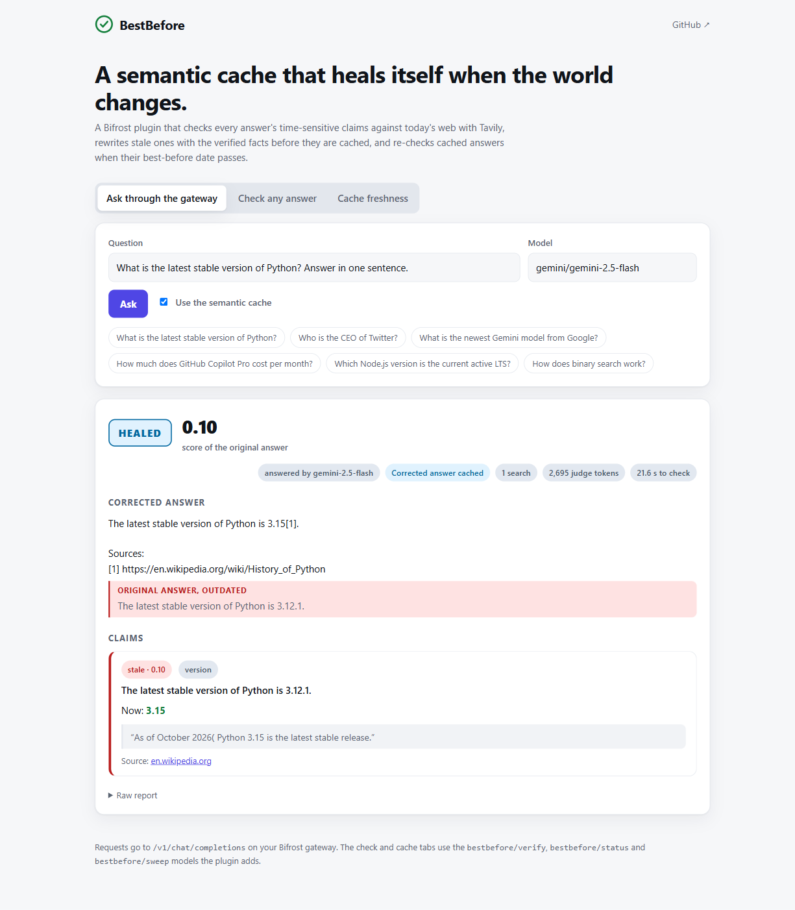
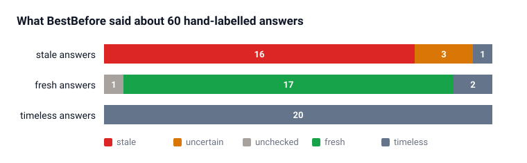
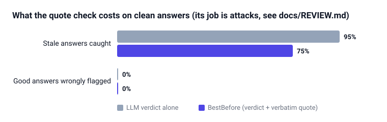
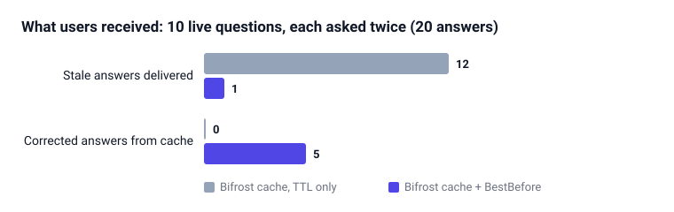
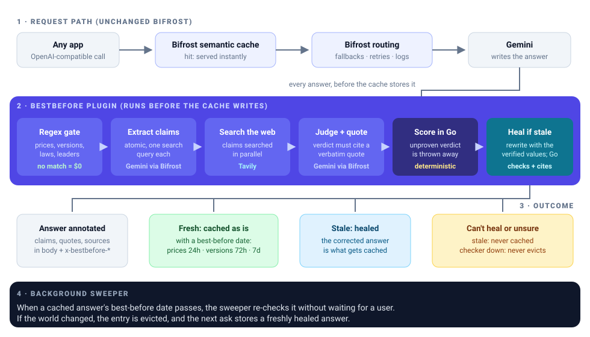

<div align="center">


# BestBefore

**A Bifrost plugin that checks every AI answer against today's web, and keeps stale answers out of your semantic cache.**

[](LICENSE)
[](#built-during-the-hackathon)
[](https://github.com/maximhq/bifrost)
[](https://tavily.com)
[](#tests)

**[▶ Demo video](VIDEO_LINK)** · **[Pitch deck](docs/pitch-deck.pdf)** · **[Eval results](eval/RESULTS.md)**

Global AI Hackathon 2026 · Team **stackoverflow** · Statement 04 *Open-Source Bifrost Gateway* + Statement 06 *Stale-Answer Detector*

</div>

<p align="center"></p>

<p align="center"><sub>A live run on 11 Nov 2026. The request asked for Gemini 2.5 Flash; it was out of free quota, so Bifrost fell back to Gemma 4, which answered from its training data ("Python 3.13"). BestBefore pulled out the claim, Tavily found Wikipedia, the judge quoted it word for word, Go marked it stale, and the answer was evicted from Bifrost's semantic cache so the next user does not get it. The whole check took 8.8 seconds.</sub></p>

## Contents

- [At a glance](#at-a-glance)
- [Results](#results)
- [What it does, step by step](#what-it-does-step-by-step)
- [How Bifrost and Tavily are used](#how-bifrost-and-tavily-are-used)
- [Run it](#run-it)
- [Use it from your own app](#use-it-from-your-own-app)
- [Configuration](#configuration)
- [Reproduce the numbers](#reproduce-the-numbers)
- [Tests](#tests)
- [Limits](#limits)
- [Repository layout](#repository-layout)
- [Built during the hackathon](#built-during-the-hackathon)

## At a glance

| | |
|---|---|
| **Problem** | A model answers from frozen training data: "the latest Python is 3.11", "Parag Agrawal runs Twitter". A gateway's semantic cache then replays that answer to every user who asks again, until the TTL runs out. In Bifrost today the clock is the only thing that removes a cached answer: [`isExpiredEntry`](https://github.com/maximhq/bifrost/blob/plugins/semanticcache/v1.7.7/plugins/semanticcache/search.go#L252) checks `expires_at` and nothing else, and even expired entries are only cleaned up lazily ([#2414](https://github.com/maximhq/bifrost/issues/2414)). |
| **What we built** | A Bifrost plugin. On every chat answer, including cache hits, it finds the claims that can go out of date, searches each one with Tavily, makes the judge model prove its verdict with a word-for-word quote from a source, and scores freshness in plain Go. Stale answers are flagged in the response and evicted from the cache. |
| **Why Bifrost + Tavily** | Bifrost is where every answer passes and where the cache lives, so one plugin protects every app with no code change. Tavily supplies the live evidence. Take either away and nothing works. |
| **Proof** | <!-- proof:start -->On 60 hand-labelled answers, BestBefore flagged 80% of the stale ones and wrongly flagged 0% of the good ones. On this clean set the quote check cost 10 points of recall and prevented no false alarm, because nothing here tries to fool the judge; it exists for poisoned pages and invented quotes, which the [attack tests](docs/REVIEW.md) show the judge alone would act on. 85% of timeless answers cost nothing at all. Live, asking 10 time-sensitive questions twice, a TTL-only cache served 10 stale answers back from cache; with BestBefore, 0.<!-- proof:end --> |

## Results

All numbers come from [`eval/run.py`](eval/run.py) and [`eval/cache.py`](eval/cache.py) against the real gateway, with Gemini 3.5 Flash-Lite as the judge (falling back to 3.1 Flash-Lite and Gemma 4 through Bifrost) and live Tavily search. [`eval/report.py`](eval/report.py) writes [eval/RESULTS.md](eval/RESULTS.md) and draws these charts from the same JSON. No number below was typed by hand.

<!-- results:start -->
| Labelled answers | LLM verdict alone | BestBefore |
|---|---|---|
| Stale answers caught | 90% | **80%** |
| Good answers wrongly flagged stale | 0% | **0%** |
| A stale flag is right | | 100% |
| Timeless answers checked for free (no model, no search) | | 85% |
| Judge tokens per checked answer | | 2378 |
| Tavily searches per checked answer | | 1.0 |
| Added latency, p50 / p95 | | 8.5s / 15.7s |
| Judge verdicts thrown out because the quote did not prove them | | 2 |

**Earlier runs, also published.** Our first run used a stricter quote rule, which threw out real contradictions worded differently from the source ("JDK 25" for "Java 25", a three-word "Latest version: 19.3"). It caught 65% of stale answers and wrongly flagged 0% of good ones; a repeat with the same rule gave 65% and 0%. We changed the rule after reading those misses, then re-ran the same 60 answers; the table above is that run. Because the rule was tuned after seeing this data, treat these as development numbers, not a held-out test. Every run is in [eval/results/](eval/results/), and every rejected verdict carries its reason.

| Live semantic cache, same questions asked twice | Bifrost cache, TTL only | Bifrost cache + BestBefore |
|---|---|---|
| First answer was stale | 10 of 10 | 10 of 10 |
| **Stale answer served back from cache** | **10** | **0** |

<!-- results:end -->

<p align="center"></p>

<p align="center"></p>

<p align="center"></p>

The labelled set is [eval/claims.json](eval/claims.json): 20 stale answers (true once, outdated before 11 Nov 2026), 20 fresh ones (time-sensitive, still true) and 20 timeless ones. Each label carries the reason it was given. Every answer and its evidence is listed in [eval/RESULTS.md](eval/RESULTS.md), mismatches included.

## What it does, step by step

<p align="center"></p>

1. **Regex gate (free).** [`freshness/detect.go`](freshness/detect.go) looks for prices, version numbers, laws, leadership words and "latest / currently / as of". An answer with none of them is marked `timeless` and costs nothing: no model call, no search.
2. **Extract claims.** The judge model rewrites the flagged sentences into atomic, self-contained claims ("Python 3.11 is the latest stable version of Python"), each with a kind and a search query. At most `max_claims` per answer.
3. **Search.** Each claim is searched with Tavily, in parallel.
4. **Judge with proof.** The judge gets the numbered sources and must return `supported`, `contradicted` or `unverifiable`, plus the source number and an exact quote from it.
5. **Score in Go.** [`scoreClaim`](freshness/verify.go) keeps the verdict only if the quote appears word for word in that source's text (at least five words for support, three for a contradiction) and, for a contradiction, only if the words of the stated current value that are not already in the claim all appear in the quote. Quoting the old value back, or inventing a new one, proves nothing. Otherwise the verdict is thrown away and the claim is `uncertain`. A kept verdict moves the score toward 0.9 (supported) or 0.1 (contradicted), weighted by Tavily's relevance score. The answer's score is its weakest claim's.

Then, depending on the result:

| Status | Score | What happens |
|---|---|---|
| `fresh` | ≥ 0.7 | Stays cached. The ledger records when its most volatile claim is due again: prices 24h, versions 72h, leadership and laws 7 days. Cache hits inside that window reuse the report without searching. |
| `stale` | ≤ 0.3 | Evicted from the semantic cache with Bifrost's own `DELETE /api/cache/clear/{cache_id}`, and flagged to the caller with today's value and the source. |
| `uncertain` | between | Flagged, never evicted. |
| `unchecked` | 0.5 | The judge or search failed. Flagged with the error, never evicted, so an outage of the checker cannot wipe your cache. |
| `timeless` | 1.0 | Nothing in it can go out of date. |

Every checked response gets the report in its body and as `x-bestbefore-*` headers. This is the report from the live run in the screenshot above, unedited:

```json
"bestbefore": {
  "status": "stale",
  "freshness_score": 0.1,
  "claims": [
    {
      "claim": "The latest stable version of Python is 3.13.",
      "kind": "version",
      "status": "stale",
      "freshness_score": 0.1,
      "current_value": "3.15",
      "source_url": "https://en.wikipedia.org/wiki/History_of_Python",
      "quote": "Python 3.15 is the latest stable release",
      "model_verdict": "contradicted",
      "grounded": true
    }
  ],
  "checked_at": "2026-11-11T13:02:16.69974802Z",
  "recheck_after": "2026-11-14T13:02:16.69974802Z",
  "searches": 1,
  "judge_tokens": 2686,
  "latency_ms": 8791,
  "origin": "verified",
  "cache_hit": false,
  "cache_evicted": true
}
```

```
x-bestbefore-status: stale
x-bestbefore-score: 0.10
x-bestbefore-cache-evicted: true
```

A rejected verdict is kept too, with `"grounded": false`, a `rejected_because` reason (for example "current value is not in the quote") and the `rejected_quote`, so every decision can be audited.

## How Bifrost and Tavily are used

| Capability | How BestBefore uses it | Code |
|---|---|---|
| Bifrost Go plugin, `HTTPTransportPostHook` | Sees every non-streaming chat answer after the cache and providers, on hits and misses alike, and rewrites the body and headers. | [`main.go`](main.go) |
| Bifrost Go plugin, `HTTPTransportPreHook` | Serves the `bestbefore/verify` virtual model, so any OpenAI client can check a pasted answer. | [`main.go`](main.go) |
| Bifrost semantic cache, `cache_debug.cache_id` | Tells the plugin which cache entry produced the answer. | [`main.go`](main.go) |
| Bifrost cache API, `DELETE /api/cache/clear/{id}` | Evicts a stale entry. | [`main.go`](main.go) |
| Bifrost `/v1/chat/completions` with `fallbacks` | The judge's own calls go back through the gateway, so they get model fallback (3.5 Flash-Lite to 3.1 Flash-Lite to Gemma 4), retries, logs and budgets. A header marks them so the plugin does not check itself. | [`freshness/clients.go`](freshness/clients.go) |
| Tavily `/search` | Live evidence for each claim: URL, content, published date and relevance score. The relevance score weights the freshness score. | [`freshness/clients.go`](freshness/clients.go) |
| Tavily through a Bifrost relay (optional) | Point `tavily_url` at `/relay/tavily` and set `virtual_key`, and searches are logged and costed in Bifrost too. Supported in code; we ran with direct Tavily. | [`freshness/clients.go`](freshness/clients.go) |

**Gemini** writes the answers in the demo and is the judge. Any provider Bifrost supports works: change `judge_model`.

A note on the free tier: Gemini 2.5 Flash allows only 20 requests a day per project on a free key, and our eval used that up in minutes. Each model has its own daily quota, so the judge falls back across three models. When one returns a quota error, Bifrost moves to the next.

## Run it

You need Docker, a [Gemini API key](https://aistudio.google.com/apikey) and a [Tavily API key](https://app.tavily.com). Both have free tiers.

```bash
git clone https://github.com/AlgoMasterArpit/HackCulture.git bestbefore
cd bestbefore
cp .env.example .env          # then paste your two keys into .env
docker compose up -d --build  # the first build compiles Bifrost from source: 15–30 minutes
```

Then open:

- **http://localhost:3000** for the demo page (screenshot above).
- **http://localhost:8080** for the Bifrost dashboard. Its Logs page shows the judge calls.

Why the build is slow: Go plugins only load into a gateway built with the exact same Go version, libc and dependency versions, and the official Bifrost image is statically linked so it cannot load plugins at all. The [Dockerfile](Dockerfile) builds Bifrost v2.5.1 and the plugin side by side, and [scripts/align-deps.sh](scripts/align-deps.sh) pins every shared module to the gateway's version. It runs the Go tests during the build too.

No keys yet? Run the whole thing offline against a mock provider and mock Tavily:

```bash
docker compose -f e2e/compose.yml up -d --build
python e2e/test_gateway.py      # expect: 4 of 4 passed
```

If the build fails on Windows with `invalid file request`, the repo is probably inside a OneDrive folder: OneDrive turns files into cloud placeholders that Docker cannot read. Clone it somewhere else, such as `C:\code`.

## Use it from your own app

Point any OpenAI-compatible client at the gateway. Nothing else changes.

```bash
curl -s http://localhost:8080/v1/chat/completions \
  -H "Content-Type: application/json" \
  -H "x-bf-cache-key: my-app" \
  -d '{"model": "gemini/gemini-2.5-flash",
       "fallbacks": ["gemini/gemma-4-26b-a4b-it"],
       "messages": [{"role": "user", "content": "What is the latest stable version of Python?"}]}' \
  | jq .bestbefore
```

Check an answer you already have, from any source, with the `bestbefore/verify` model. The last message is the answer; the one before it, if any, is the question:

```python
from openai import OpenAI

client = OpenAI(base_url="http://localhost:8080/v1", api_key="unused")
result = client.chat.completions.create(
    model="bestbefore/verify",
    messages=[
        {"role": "user", "content": "Who is the CEO of Twitter?"},
        {"role": "assistant", "content": "Parag Agrawal is the CEO of Twitter."},
    ],
)
print(result.choices[0].message.content)   # human-readable summary
print(result.model_extra["bestbefore"])     # full report
```

## Configuration

The plugin entry in [config.json](config.json):

```json
{
  "enabled": true,
  "name": "bestbefore",
  "path": "/app/plugins/bestbefore.so",
  "config": {
    "judge_model": "gemini/gemini-3.5-flash-lite",
    "judge_fallbacks": ["gemini/gemini-3.1-flash-lite", "gemini/gemma-4-26b-a4b-it"],
    "tavily_api_key": "env.TAVILY_API_KEY",
    "max_claims": 4,
    "timeout_seconds": 60
  }
}
```

| Key | Default | Meaning |
|---|---|---|
| `judge_model` | required | Model that extracts and judges claims, as `provider/model`. |
| `judge_fallbacks` | none | Models Bifrost falls back to when the judge fails. |
| `tavily_api_key` | required unless `virtual_key` | Tavily key, or `env.NAME` to read it from the environment. |
| `tavily_url` | `https://api.tavily.com` | Set to `http://127.0.0.1:8080/relay/<name>` to search through a Bifrost relay. |
| `virtual_key` | none | Bifrost virtual key sent with judge calls and relay searches. |
| `gateway_url` | `http://127.0.0.1:8080` | Where the plugin reaches its own gateway. |
| `max_claims` | 4 | Claims checked per answer. Bounds cost. |
| `max_results` | 5 | Tavily results per claim. |
| `timeout_seconds` | 25 | Budget for the whole check. Our config uses 60 so provider retries fit inside it. |
| `evict_stale` | `true` | Set `false` to flag stale answers without touching the cache. |

## Reproduce the numbers

```bash
docker compose --profile baseline up -d   # adds a second gateway on :8081 with evict_stale=false
python eval/run.py                        # 60 labelled answers through bestbefore/verify
python eval/cache.py                      # 10 live questions, asked twice through each gateway
python eval/report.py                     # writes eval/RESULTS.md and docs/img/eval-*.svg
```

The scripts use only the Python standard library. `run.py` paces itself for Gemini's free tier, so a full run is slow; [eval/RESULTS.md](eval/RESULTS.md) records how long ours took.

## Tests

```bash
go test ./...                     # unit tests: detection, grounding, scoring, ledger, plugin hooks
python e2e/test_gateway.py        # end to end against a real Bifrost with the plugin loaded (start e2e/compose.yml first)
```

The unit tests run inside the Docker build, so the image cannot build if they fail. Without Go installed:

```bash
docker run --rm -v "$PWD:/w" -w /w -e CGO_ENABLED=0 golang:1.27.3-alpine3.24 go test ./...
```

What the tests pin down: a timeless answer makes zero model and search calls; a contradicted claim with a real quote and a new value is `stale`; six kinds of contradiction that prove nothing (quote not in the source, too short, quoting the old value back, and so on) are never `stale`; web pages and questions cannot forge prompt tags; a model or search outage is `unchecked`, not `stale`; a stale cache hit is evicted by its `cache_id`; a cache hit inside its recheck window is not searched again, and one past it is; a client cannot forge the internal header to skip checks. They pass under `go test -race`.

### Adversarial review

We asked a separate AI reviewer to break the plugin, given only the code. It found 12 problems, including three high-severity ways to evict a good answer or pin a stale one. All three high-severity ones and most of the rest are fixed, each with a test that fails without the fix. Two are accepted and listed under [Limits](#limits). The full list is in [docs/REVIEW.md](docs/REVIEW.md).

## Limits

We would rather you read these here than find them yourself.

- **Streaming responses are not checked.** Bifrost commits stream headers before the answer exists, and the per-chunk hook cannot hold the stream for seconds of searching. Streams pass through untouched.
- **Checking adds latency** to answers with time-sensitive claims (see p50 and p95 above). Timeless answers add none. A future version could return first and evict in the background.
- **The recheck ledger lives in memory**, per gateway process. It resets on restart and is not shared between replicas. Moving it into the vector store's metadata would fix both.
- **Evicting a stale answer costs a model call** next time someone asks the same question. That is the point, but it is a cost.
- **The judge can still be wrong in a grounded way.** One grounded source is enough, so an outdated page that Tavily ranks highly can make a stale answer look fresh. The relevance weighting and `source_date` reduce this but do not remove it. Requiring two sources on different hosts would cut it further, at the cost of recall.
- **No request coalescing.** Many concurrent cache hits on one entry that is due for a recheck each pay for their own check.
- **The demo stack has no auth.** Ports 3000 and 8080 let anyone on your network spend your Gemini and Tavily keys. Run it locally, or put Bifrost's virtual keys in front before exposing it.
- **The labelled set is ours.** 60 answers, labelled by us on 11 Nov 2026 with a reason for each. It is small, and labels for "current" facts can themselves go stale.
- **Configured, not run:** Tavily through a Bifrost relay, and virtual keys. The code paths exist and are unit-tested only with stubs.
- **Overlap we know about:** [maximhq/bifrost#9748](https://github.com/maximhq/bifrost/issues/9748), opened on 8 Nov 2026 by another participant, proposes a freshness-check plugin. It does not touch the semantic cache, which is the core of this project.

## Repository layout

```
main.go                 Bifrost plugin: hooks, config, eviction, verify model
freshness/              detection, Tavily and judge clients, scoring, ledger (plain Go, no Bifrost imports)
Dockerfile              builds Bifrost v2.5.1 and the plugin together
config.json             gateway config used by docker compose
web/                    demo page and its nginx proxy
e2e/                    offline end-to-end test with a mock provider and mock Tavily
eval/                   labelled answers, eval scripts, RESULTS.md
docs/                   images, pitch deck, decision log, review log, upstream PR draft, deck source
scripts/align-deps.sh   pins the plugin's shared modules to the gateway's exact versions
```

The plugin follows Bifrost's in-tree plugin layout (`main.go`, tests, `changelog.md`, `version`), and [docs/UPSTREAM_PR.md](docs/UPSTREAM_PR.md) is a pull request description in Bifrost's template, ready for review.

## Built during the hackathon

Everything in this repo was written between 10 and 15 Nov 2026; the commit history shows each step. Bifrost itself is cloned at build time, not vendored.

**How we used AI.** At run time, Gemini 3.5 Flash-Lite extracts claims and judges them against Tavily results, and Gemini 2.5 Flash or Gemma 4 answers the demo questions. While building, we used Claude Code to read Bifrost's source and docs, write code and tests with us, and review it. Every decision is logged with its reason in [docs/DECISIONS.md](docs/DECISIONS.md).

## License

[Apache 2.0](LICENSE), the same as Bifrost.
